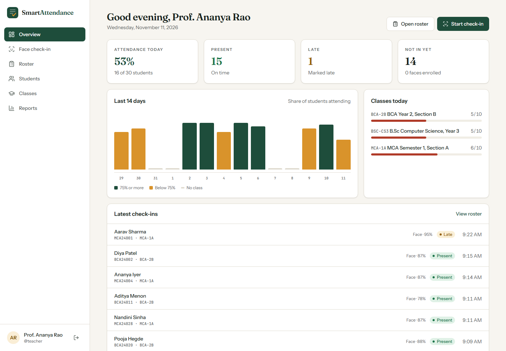
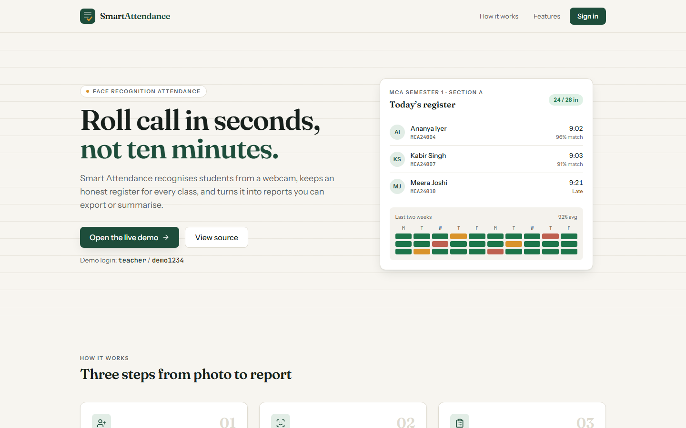
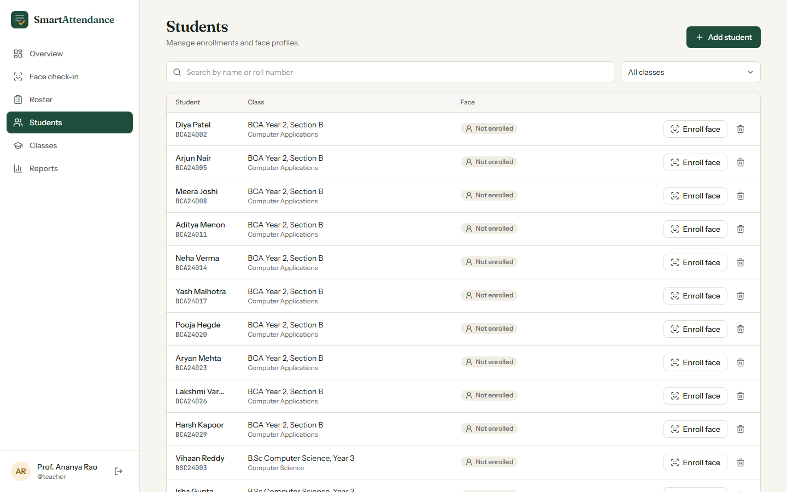
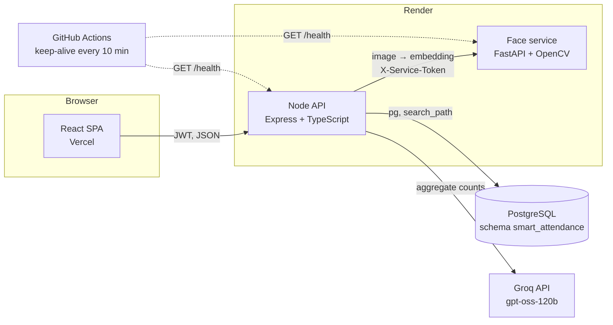

# Smart Attendance

> Face recognition attendance for classrooms: students check in from a webcam, teachers fix the roster in one tap, and reports export to CSV or become short AI summaries.

[](https://github.com/HarshBathija-04/Smart-Attendence/actions/workflows/ci.yml)

**Live demo:** `https://<your-app>.vercel.app` (frontend) · API `https://smart-attendance-api.onrender.com` · face service `https://smart-attendance-face.onrender.com`
**Demo login:** `teacher` / `demo1234`

> The API and face service run on Render's free tier and sleep when idle. The first request after a while can take 30 to 60 seconds; the app shows a "waking up the server" notice while it waits.



## Features

- **Face check-in.** Webcam (or photo upload) recognition with OpenCV YuNet detection and SFace embeddings. Each student is marked once per day, and every check-in stores its match score.
- **Proxy resistance.** Enrollment rejects group photos and faces that are already enrolled for another student. Only the 128-number embedding is stored, never the photo.
- **Class roster.** Present, late or absent per student for any past date, with bulk "mark remaining present". Face and manual entries live side by side.
- **Student and class management.** Create, edit and delete classes and students, enroll or re-enroll faces, and search or filter by class.
- **Reports.** Per-student sessions, present, late, absent and attendance rate for any date range and class. Sortable, with CSV export (formula-injection safe).
- **AI summaries.** One click sends roll numbers and counts (no names, no face data) to Groq `openai/gpt-oss-120b`, which returns a short brief on who is below 75%, lateness patterns and a next step.
- **Dashboard.** Today's attendance, a 14-day ledger chart, per-class progress and the latest check-ins.
- **Production hygiene.** JWT auth with bcrypt hashes, zod validation on every endpoint, helmet, a CORS allow-list, rate limits on auth, face and AI routes, consistent JSON errors, and `/health` endpoints that check the database.

## Screenshots

| Landing | Reports |
| --- | --- |
|  |  |
| **Students** | **Classes** |
|  |  |

## Architecture



The face service is stateless: it turns an image into a normalised 128-dimensional SFace embedding. The API owns the database, compares embeddings with cosine similarity (threshold 0.363, the SFace reference value) and records attendance. Groq is called only from the API, never from the browser.

## Tech stack

| Layer | Tools |
| --- | --- |
| Frontend | React 19, TypeScript, Vite, Tailwind CSS, React Router, lucide-react, sonner |
| API | Node 22, Express 5, TypeScript, pg, zod, jsonwebtoken, bcryptjs, helmet, express-rate-limit, groq-sdk |
| Face service | Python 3.13, FastAPI, uvicorn, OpenCV (YuNet face detector + SFace recogniser), NumPy |
| Data | PostgreSQL (one schema per app via `DB_SCHEMA`), plain SQL migrations, idempotent seed |
| Quality | Vitest + Supertest (API against real Postgres), pytest, ESLint, Prettier, Ruff, GitHub Actions |

## Local setup

Prerequisites: Node 20+, Python 3.13, and a PostgreSQL database (for example `docker run -p 5433:5432 -e POSTGRES_PASSWORD=postgres -e POSTGRES_DB=portfolio postgres:16`).

```bash
# 1. Face service (port 5129)
cd smart-attendance-system/face-service
python -m venv .venv
.venv/Scripts/activate          # Windows; use `source .venv/bin/activate` on macOS/Linux
pip install -r requirements-dev.txt
python -m app.models             # downloads and checksum-verifies the two ONNX models
uvicorn app.main:app --port 5129

# 2. API (port 5128)
cd ../backend
cp .env.example .env             # set DATABASE_URL, JWT_SECRET, optionally GROQ_API_KEY
npm install
npm run db:setup                 # create schema, run migrations, seed demo data
npm run dev

# 3. Frontend (port 5214)
cd ../frontend
cp .env.example .env             # VITE_API_URL=http://localhost:5128
npm install
npm run dev
```

Open http://localhost:5214 and sign in with `teacher` / `demo1234`. The seeded students have no faces, so to try recognition, enroll yourself on the Students page and then use Face check-in.

Checks: `npm run lint && npm test && npm run build` in `backend/` and `frontend/`; `ruff check . && pytest` in `face-service/`.

## Environment variables

### API (`smart-attendance-system/backend`)

| Variable | Required | Default | Description |
| --- | --- | --- | --- |
| `DATABASE_URL` | yes | | Postgres connection string (append `?sslmode=require` for external connections) |
| `DB_SCHEMA` | no | `smart_attendance` | Schema holding this app's tables; created automatically |
| `JWT_SECRET` | in production | dev-only fallback | Secret for signing session tokens |
| `FRONTEND_URL` | no | `http://localhost:5214` | Comma-separated list of allowed CORS origins |
| `FACE_SERVICE_URL` | no | `http://localhost:5129` | Base URL of the face service |
| `FACE_SERVICE_TOKEN` | no | empty | Shared secret sent to the face service |
| `FACE_MATCH_THRESHOLD` | no | `0.363` | Minimum cosine similarity for a match |
| `GROQ_API_KEY` | for AI summaries | | Groq API key; without it the AI summary returns a friendly 503 |
| `GROQ_MODEL` | no | `openai/gpt-oss-120b` | Groq model for summaries |
| `APP_TIMEZONE` | no | `Asia/Kolkata` | Timezone that defines "today" |
| `SEED_DEMO_DATA` | no | `true` | Seed demo classes, students and six weeks of history |
| `DEMO_PASSWORD` | no | `demo1234` | Password for the seeded `teacher` account |
| `PORT`, `NODE_ENV` | no | `5128`, `development` | |

### Face service (`smart-attendance-system/face-service`)

| Variable | Default | Description |
| --- | --- | --- |
| `FACE_SERVICE_TOKEN` | empty (auth off) | Required `X-Service-Token` header value |
| `MODEL_DIR` | `./models` | Where the ONNX models live |
| `ENV` | | Set to `production` to disable `/docs` |

### Frontend (`smart-attendance-system/frontend`)

| Variable | Description |
| --- | --- |
| `VITE_API_URL` | Base URL of the API, e.g. `https://smart-attendance-api.onrender.com` |

## Deployment

1. **Database.** Use the shared Render PostgreSQL instance (created once by hand). This app keeps its tables in the `smart_attendance` schema, so it can share the database with other apps.
2. **Render Blueprint.** In Render, choose *New → Blueprint* and select this repository. `render.yaml` creates `smart-attendance-api` and `smart-attendance-face` (both free, `healthCheckPath: /health`). When prompted, set:
   - `DATABASE_URL`: the shared database's internal connection string
   - `GROQ_API_KEY`: your Groq key
   - `FRONTEND_URL`: your Vercel URL (add preview URLs separated by commas)
   - `FACE_SERVICE_URL`: the face service's public URL, e.g. `https://smart-attendance-face.onrender.com`

   `JWT_SECRET` and `FACE_SERVICE_TOKEN` are generated automatically and shared between the services. Migrations and the idempotent seed run on every start.
3. **Vercel.** Import the repository, set **Root Directory** to `smart-attendance-system/frontend` (Vite preset) and add `VITE_API_URL` pointing at the API. `vercel.json` handles SPA rewrites and security headers.
4. **Keep-alive.** In GitHub, under *Settings → Secrets and variables → Actions → Variables*, add `BACKEND_URL` (API URL) and `AI_SERVICE_URL` (face service URL). `.github/workflows/keep-alive.yml` pings both `/health` endpoints every 10 minutes; it skips cleanly if the variables are unset.

## Project structure

```
.
├── render.yaml                      # Render Blueprint (API + face service)
├── .github/workflows/
│   ├── ci.yml                       # lint, test and build for each package
│   └── keep-alive.yml               # pings /health every 10 minutes
└── smart-attendance-system/
    ├── backend/                     # Express API
    │   ├── migrations/001_init.sql  # users, classes, students, attendance
    │   ├── src/
    │   │   ├── app.ts               # middleware, routing, /health
    │   │   ├── auth.ts              # login, JWT middleware
    │   │   ├── face.ts              # face-service client, cosine matching
    │   │   ├── ai.ts                # Groq summaries
    │   │   ├── routes/              # classes, students, attendance, reports, dashboard
    │   │   ├── db.ts, migrate.ts, seed.ts
    │   │   └── server.ts
    │   └── test/                    # unit + API tests (supertest, real Postgres)
    ├── face-service/                # FastAPI embedding service
    │   ├── app/main.py              # /health, /embed
    │   ├── app/models.py            # model download + SHA-256 verification
    │   └── tests/
    ├── frontend/                    # React SPA
    │   ├── src/pages/               # Landing, Login, Dashboard, CheckIn, Roster, Students, Classes, Reports
    │   ├── src/components/          # UI kit, layout, camera capture
    │   └── src/lib/                 # API client, auth, CSV, markdown, formatting
    └── docs/screenshots/
```

## Accuracy notes

SFace reports about 99.4% accuracy on LFW. In practice, recognition quality depends on lighting and camera angle, so enroll faces in the same conditions where check-in happens. Every check-in stores its similarity score so that borderline matches can be audited from the roster.
