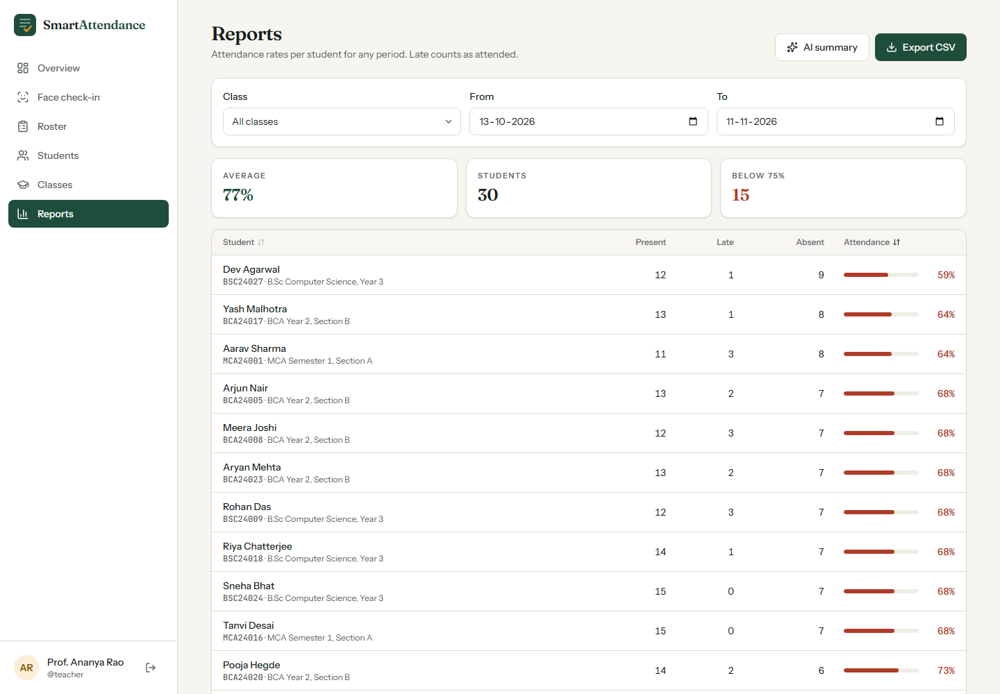
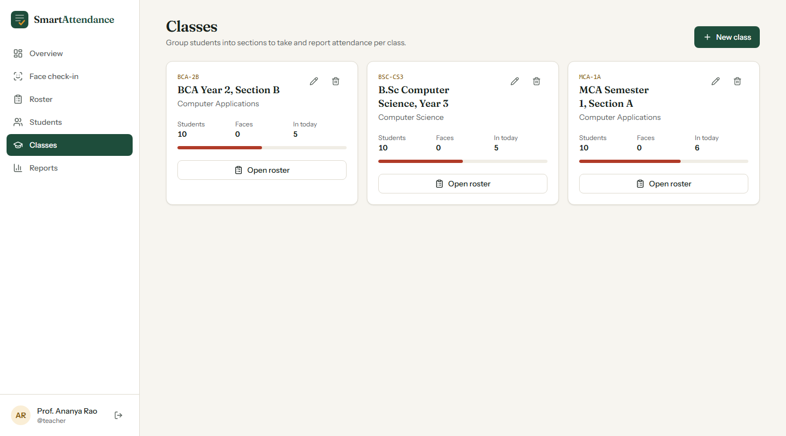
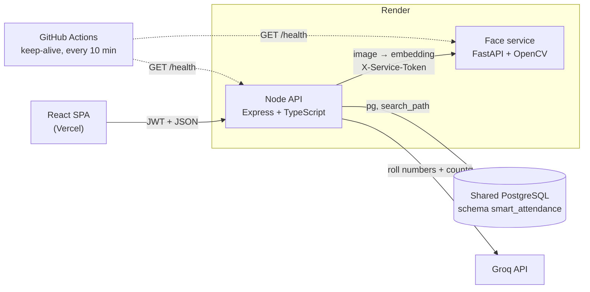

# Smart Attendance

**Face recognition attendance for classrooms.** Students check in from a webcam, teachers fix the register in one tap, and reports export to CSV or turn into a short AI brief.

[](https://github.com/HarshBathija-04/Smart-Attendence/actions/workflows/ci.yml)


| | |
| --- | --- |
| **Live demo** | `https://<your-app>.vercel.app` |
| **API** | `https://<your-api>.onrender.com/health` |
| **Demo login** | `teacher` / `demo1234` |

> The API and face service run on Render's free tier and sleep when idle, so the first request can take 30 to 60 seconds. The app shows a "Waking up the server" notice while it waits.


## Features

- **Face check-in** from a webcam or an uploaded photo (OpenCV YuNet detection + SFace embeddings). Each student is marked once per day, and every check-in keeps its match score.
- **Proxy resistance.** Enrollment rejects group photos and faces already enrolled for another student.
- **Class roster** for any past date: present, late or absent, with "Mark remaining present". Face and manual entries live side by side.
- **Students and classes**: create, edit, delete, search, filter, enroll or re-enroll faces.
- **Reports** per student for any date range and class, sortable, with CSV export.
- **AI summaries** via Groq (`openai/gpt-oss-120b`): who is below 75%, lateness patterns and a next step.
- **Dashboard** with today's numbers, a 14-day chart, per-class progress and the latest check-ins.

## Screenshots

| Landing | Reports |
| --- | --- |
|  |  |
| **Students** | **Classes** |
|  |  |

## Architecture



The face service is stateless: it turns an image into a normalized 128-dimensional embedding. The API owns the database, compares embeddings with cosine similarity (threshold 0.363, the SFace reference value) and records attendance. Groq is called only from the API, never from the browser.

## Tech stack

| Layer | Tools |
| --- | --- |
| Frontend | React 19, TypeScript, Vite, Tailwind CSS, React Router, lucide-react, sonner |
| API | Node 22, Express 5, TypeScript, pg, zod, jsonwebtoken, bcryptjs, helmet, express-rate-limit, groq-sdk |
| Face service | Python 3.13, FastAPI, uvicorn, OpenCV (YuNet + SFace), NumPy |
| Data | PostgreSQL, one schema per app (`DB_SCHEMA`), plain SQL migrations, idempotent seed |
| Quality | Vitest + Supertest against real Postgres, pytest, ESLint, Prettier, Ruff, GitHub Actions |

## Engineering highlights

- **Schema-per-app database.** Several portfolio apps share one Postgres instance. This one lives in its own schema, set with `DB_SCHEMA` (validated as a SQL identifier) and applied through the connection's `search_path`, so no query names a schema.
- **Race-safe, once-a-day check-in.** `UNIQUE (student_id, date)` plus `INSERT ... ON CONFLICT DO NOTHING` means two simultaneous scans of the same student cannot create two records.
- **Transaction-safe roster saves.** A bulk roster update runs in one transaction, so a failed save leaves the day's register exactly as it was. Each migration also runs in its own transaction.
- **Stateless face service.** It holds no data and needs a shared `X-Service-Token` (checked in constant time), so it can sleep, restart or scale without losing anything.
- **Privacy by design.** Only the embedding is stored, never the photo, and API responses never include it. The AI prompt contains roll numbers and counts only, never names.
- **Built for free-tier hosting.** The frontend notices slow requests and shows a cold-start banner; a scheduled workflow keeps both services warm; migrations and the deterministic seed run on every boot.
- **Defensive by default.** zod on every input, helmet, a CORS allow-list, rate limits on login, face and AI routes, timing-uniform login, consistent JSON errors and CSV export that neutralizes spreadsheet formulas.

## Quick start

Prerequisites: Node 20+, Python 3.13 and PostgreSQL. For a throwaway database:

```bash
docker run -d -p 5433:5432 -e POSTGRES_PASSWORD=postgres -e POSTGRES_DB=portfolio postgres:16
```

```bash
# 1. Face service on :5129
cd smart-attendance-system/face-service
python -m venv .venv
source .venv/bin/activate          # Windows: .venv\Scripts\activate
pip install -r requirements-dev.txt
python -m app.models               # downloads and SHA-256 checks the two ONNX models
uvicorn app.main:app --port 5129

# 2. API on :5128 (new terminal)
cd smart-attendance-system/backend
cp .env.example .env               # DATABASE_URL already points at the docker database above
npm install
npm run db:setup                   # creates the schema, runs migrations, seeds demo data
npm run dev

# 3. Frontend on :5214 (new terminal)
cd smart-attendance-system/frontend
cp .env.example .env
npm install
npm run dev
```

Open http://localhost:5214 and choose **Sign in with demo account**. The seeded students have no faces, so to try recognition, enroll your own face on the Students page and then open Face check-in.

Checks: `npm run lint && npm test && npm run build` in `backend/` and `frontend/`, and `ruff check . && pytest` in `face-service/`.

## Environment variables

**API** (`smart-attendance-system/backend/.env`)

| Variable | Required | Default | Purpose |
| --- | --- | --- | --- |
| `DATABASE_URL` | yes | | Postgres connection string |
| `DB_SCHEMA` | no | `smart_attendance` | Schema that holds this app's tables; created automatically |
| `JWT_SECRET` | in production | dev-only fallback | Signs session tokens |
| `FRONTEND_URL` | no | `http://localhost:5214` | Allowed CORS origins, comma-separated |
| `FACE_SERVICE_URL` | no | `http://localhost:5129` | Base URL of the face service |
| `FACE_SERVICE_TOKEN` | no | empty | Shared secret sent to the face service |
| `FACE_MATCH_THRESHOLD` | no | `0.363` | Minimum cosine similarity for a match |
| `GROQ_API_KEY` | for AI summaries | | Without it, AI summary returns a clear 503 |
| `GROQ_MODEL` | no | `openai/gpt-oss-120b` | Groq model |
| `APP_TIMEZONE` | no | `Asia/Kolkata` | Timezone that defines "today" |
| `SEED_DEMO_DATA` | no | `true` | Seed demo classes, students and six weeks of history |
| `DEMO_PASSWORD` | no | `demo1234` | Password for the seeded `teacher` account |
| `PORT`, `NODE_ENV` | no | `5128`, `development` | |

**Face service** (`smart-attendance-system/face-service`)

| Variable | Default | Purpose |
| --- | --- | --- |
| `FACE_SERVICE_TOKEN` | empty (auth off) | Required `X-Service-Token` value |
| `MODEL_DIR` | `./models` | Where the ONNX models live |
| `ENV` | | `production` disables `/docs` |

**Frontend** (`smart-attendance-system/frontend/.env`)

| Variable | Purpose |
| --- | --- |
| `VITE_API_URL` | Base URL of the API, for example `https://<your-api>.onrender.com` |

## Deploy

1. **Database.** Use the shared Render PostgreSQL instance (created once, by hand). The Blueprint deliberately has no `databases:` block.
2. **Render Blueprint.** In Render choose *New → Blueprint* and pick this repository. `render.yaml` creates `smart-attendance-api` and `smart-attendance-face` (free plan, `healthCheckPath: /health`) and sets `DB_SCHEMA=smart_attendance`. When prompted, fill in:
   - `DATABASE_URL`: the shared database's **internal** connection string
   - `GROQ_API_KEY`: your Groq key
   - `FRONTEND_URL`: your Vercel URL (add preview URLs separated by commas)
   - `FACE_SERVICE_URL`: the face service URL, for example `https://smart-attendance-face.onrender.com`

   `JWT_SECRET` and `FACE_SERVICE_TOKEN` are generated by Render and shared between the two services. Migrations and the idempotent seed run on every start.
3. **Vercel.** Import the repository, set **Root Directory** to `smart-attendance-system/frontend` (Vite preset) and add `VITE_API_URL` pointing at the API. `vercel.json` handles SPA rewrites, security headers and asset caching.
4. **Keep-alive.** In GitHub go to *Settings → Secrets and variables → Actions → Variables* and add `BACKEND_URL` (the API URL) and `AI_SERVICE_URL` (the face service URL). `.github/workflows/keep-alive.yml` pings both `/health` endpoints every 10 minutes and skips cleanly when a variable is missing.

## Project structure

```
.
├── render.yaml                    # Render Blueprint: API + face service
├── .github/workflows/
│   ├── ci.yml                     # lint, test and build each package
│   └── keep-alive.yml             # pings /health every 10 minutes
└── smart-attendance-system/
    ├── backend/                   # Express API
    │   ├── migrations/            # plain SQL, applied in order
    │   ├── src/
    │   │   ├── app.ts             # middleware, rate limits, routing, /health
    │   │   ├── auth.ts            # login and JWT middleware
    │   │   ├── face.ts            # face-service client, cosine matching
    │   │   ├── ai.ts              # Groq summaries
    │   │   ├── routes/            # classes, students, attendance, reports, dashboard
    │   │   └── db.ts, migrate.ts, seed.ts, server.ts
    │   └── test/                  # unit tests + API tests on real Postgres
    ├── face-service/              # FastAPI: /health, /embed
    │   ├── app/main.py
    │   ├── app/models.py          # model download + checksum
    │   └── tests/
    ├── frontend/                  # React SPA
    │   └── src/{pages,components,lib}
    └── docs/screenshots/
```

## Privacy

- Only a 128-number face embedding is stored per student. Photos are discarded after embedding and embeddings never appear in API responses.
- AI summaries receive roll numbers and attendance counts only, never names or face data.
- **Demo face data must be synthetic or consented.** Only enroll your own face, or faces of people who have explicitly agreed, and never commit captured images or embeddings to the repository. Earlier commits in this repository's history contained captured face data; it has been removed from the current tree.

## Accuracy notes

SFace reports about 99.4% accuracy on LFW. Real-world quality depends on lighting and camera angle, so enroll faces in the same conditions where check-in happens. Every check-in stores its similarity score, so borderline matches can be audited from the roster.
